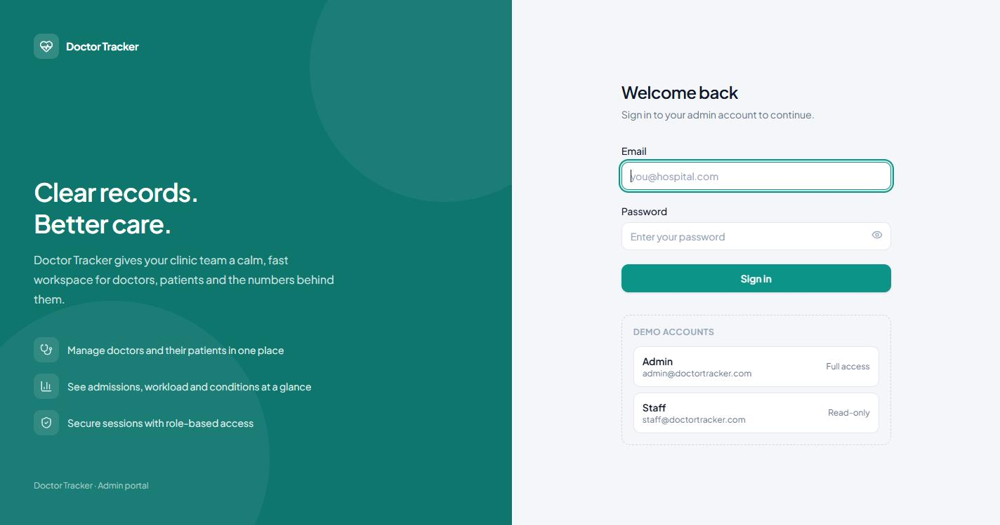
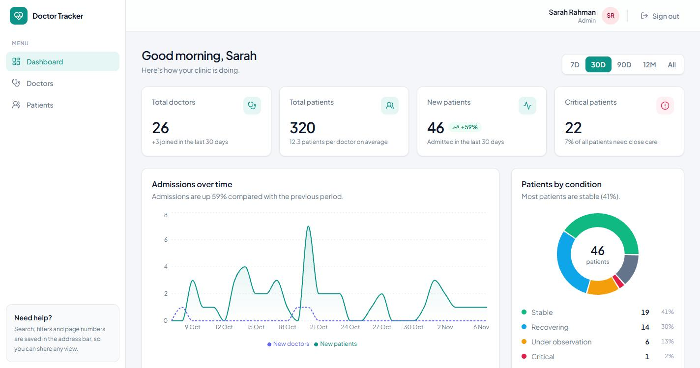
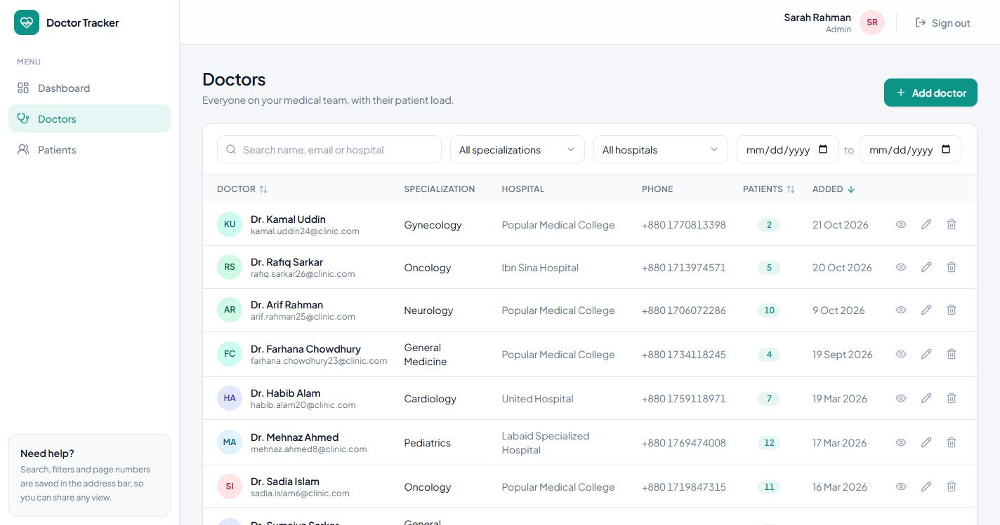
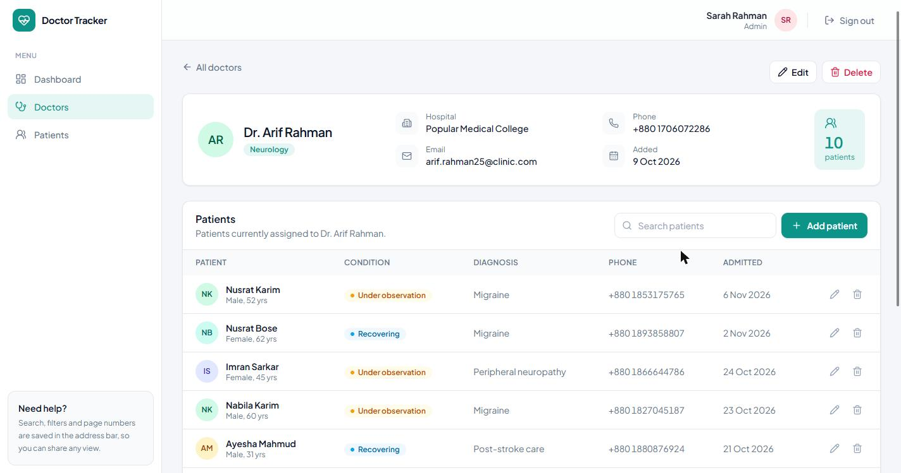
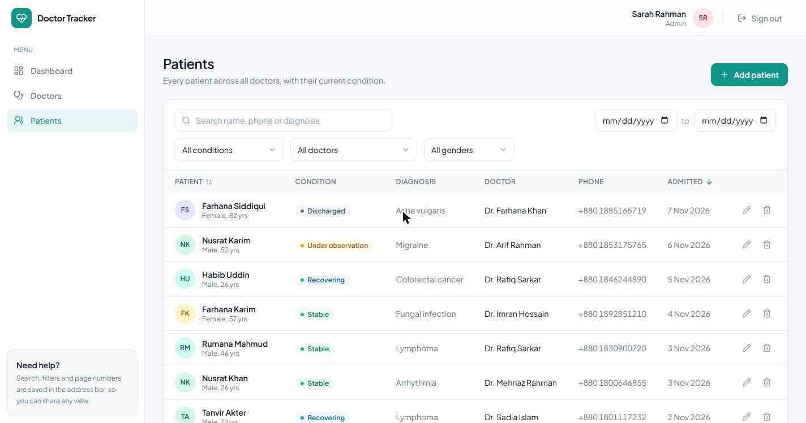
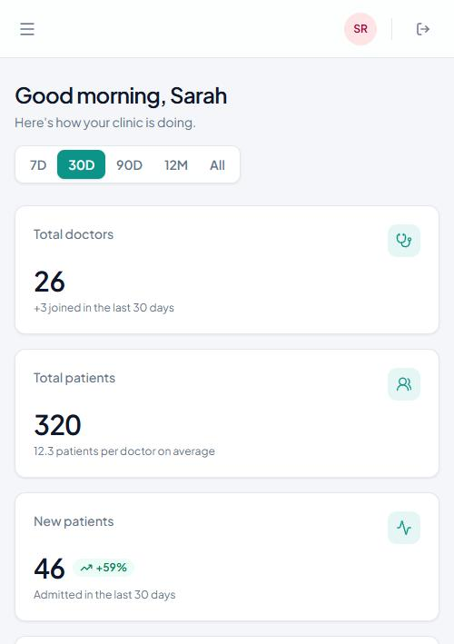
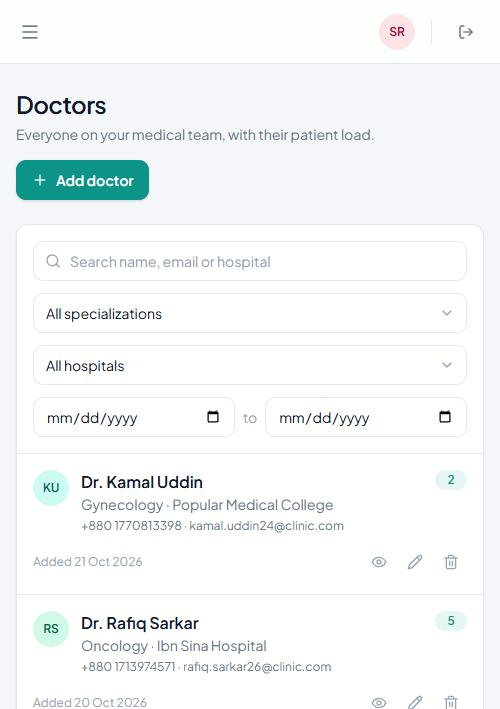
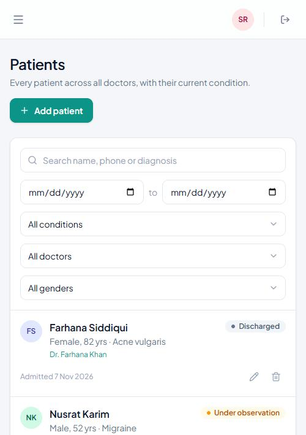

# Doctor Tracker: Frontend

## Description

**Doctor Tracker** is a secure admin portal for clinics and hospitals. Signed-in staff can manage their
doctors and each doctor's patients, then see the numbers behind them on one dashboard. Doctors and
patients can be searched, filtered by date and other fields, sorted and paginated. Patients can be added
under a specific doctor, edited or deleted. The dashboard shows totals, patients per doctor,
condition breakdowns and admission trends for any date range. Admins have full access and staff have
read-only access, so everyone sees the same live picture without stepping on each other.

This repository is the **Next.js frontend**. It talks to a separate **Express + MongoDB REST API** and
ships with a built-in mock API that follows the same contract, so it runs on its own today.

---

## Setup guide

**Requirements:** Node.js 20 or newer, npm 10 or newer.

```bash
# 1. Get the code
git clone https://github.com/atik806/doctor-tracker-frontend.git
cd doctor-tracker-frontend

# 2. Install dependencies
npm install

# 3. Create your environment file
cp .env.example .env.local        # Windows PowerShell: Copy-Item .env.example .env.local

# 4. Start the dev server
npm run dev
```

Open **http://localhost:3000** and sign in with one of the demo accounts:

| Role  | Email                     | Password    | Access                           |
|-------|---------------------------|-------------|----------------------------------|
| Admin | `admin@doctortracker.com` | `Admin@123` | Full access: create, edit, delete |
| Staff | `staff@doctortracker.com` | `Staff@123` | Read-only                        |

The login page also has buttons that fill these in for you.

### Environment variables (`.env.example`)

| Variable         | Required | What it does |
|------------------|----------|--------------|
| `API_URL`        | No       | Base URL of the Express backend, e.g. `http://localhost:5000` (see the [backend repo](https://github.com/atik806/doctor-tracker-backend)). **Leave empty to use the built-in mock API.** |
| `SESSION_SECRET` | Backend  | Secret the backend uses to sign session tokens. The mock API doesn't need it. |

### Scripts

| Command         | Purpose                         |
|-----------------|---------------------------------|
| `npm run dev`   | Start the dev server on port 3000 |
| `npm run build` | Production build (with type-checking) |
| `npm start`     | Serve the production build      |
| `npm run lint`  | ESLint                          |

> The mock API keeps its data in memory. Restarting the server resets it to the seed data
> (26 doctors, 320 patients) and signs everyone out.

---

## System architecture

```
┌──────────────┐  fetch('/api/...')   ┌───────────────────────────┐   rewrite    ┌──────────────┐     ┌─────────┐
│   Browser    │ ───────────────────▶ │       Next.js app         │ ───────────▶ │ Express API  │ ──▶ │ MongoDB │
│ React +      │  httpOnly cookie     │  proxy.ts (route guard)   │  (API_URL    │ auth, CRUD,  │     │         │
│ TanStack     │ ◀─────────────────── │  pages (App Router)       │   is set)    │ aggregation  │ ◀── │         │
│ Query        │        JSON          │  /api/* mock route        │              └──────────────┘     └─────────┘
└──────────────┘                      │  handlers (API_URL empty) │
                                      └───────────────────────────┘
```

**How a request flows**

1. A page component reads its filters from the URL (`?search=ali&condition=critical&page=2`) and calls
   `useQuery`, which calls one function in `src/lib/api.ts`.
2. `api.ts` sends `fetch("/api/patients?...")` to the **same origin**, so the browser attaches the
   `httpOnly` session cookie automatically.
3. Next.js routes the request:
   - **`API_URL` is set:** `next.config.ts` rewrites `/api/*` to `${API_URL}/api/*` (Express).
   - **`API_URL` is empty:** the route handlers in `src/app/api/` answer from in-memory data.
4. The API checks the session (**401** if missing or expired) and the role (**403** if a staff user tries
   to write), validates the input (**400** with per-field errors), then returns JSON.
5. TanStack Query caches the result per filter combination. After a create, edit or delete, the related
   queries are invalidated and refetched, and a toast confirms the change.

**Authentication and authorization**

- `POST /api/auth/login` checks the credentials and sets a `dt_session` cookie that is `httpOnly`,
  `SameSite=Lax`, and `Secure` in production. JavaScript never sees the token.
- `src/proxy.ts` (Next 16's middleware) redirects any page request without a session to
  `/login?next=<page>`. After sign-in, the user returns to that page.
- Every API route calls `checkAccess(request, "any" | "admin")`. The UI also hides write actions from
  staff users, but the API check is what actually enforces it.
- If the API ever answers `401`, the client clears the cookie and does a full reload to `/login`, which
  wipes every cached query from the old session.

**REST contract** (the Express backend implements the same endpoints)

```
POST   /api/auth/login | /api/auth/logout      GET /api/auth/me
GET    /api/doctors          ?search&specialization&hospital&from&to&sort&page&limit
POST   /api/doctors          GET|PUT|DELETE /api/doctors/:id
GET    /api/doctors/:id/patients ?search&page&limit       POST /api/doctors/:id/patients
GET    /api/patients         ?search&condition&doctorId&gender&from&to&sort&page&limit
POST   /api/patients         PUT|DELETE /api/patients/:id
GET    /api/stats            ?range=7d|30d|90d|12m|all
GET    /api/options          → { specializations, hospitals, doctors }

List  → { data: [...], meta: { page, limit, total, totalPages } }   (limit is capped at 100)
Item  → { data: {...} }
Error → { message, errors?: { field: message } }   with 400 / 401 / 403 / 404 / 409 / 500
```

**The backend** lives in its own repo, [doctor-tracker-backend](https://github.com/atik806/doctor-tracker-backend) (Express 5 + Mongoose + MongoDB). In short:

- Every list filter and sort is backed by an index (checked with `explain()`: index scans only).
- The page and the total count are fetched in parallel. Patient lists load doctor names in one extra
  query (no N+1).
- Each doctor stores a `patientCount` that is kept up to date on every patient change, so sorting by
  patient count is an index scan.
- The dashboard is built from MongoDB aggregation pipelines (`$match` on dates, then `$group`).

**Folder structure**

```
src/
  app/
    login/                    public sign-in page
    (portal)/                 signed-in shell: layout, loading, error
      dashboard/  doctors/  doctors/[id]/  patients/
    api/                      mock REST API (route handlers)
  components/
    ui/                       reusable building blocks (Button, Modal, Pagination, SearchInput, ...)
    layout/                   Sidebar, Topbar, PageHeader
    auth/ doctors/ patients/ dashboard/    feature components
  lib/        api.ts (every request), hooks.ts, validation.ts (shared rules), format.ts
  mock/       seed data, in-memory store, stats aggregation, session handling
  types/      shared TypeScript types
  proxy.ts    route protection
```

---

## Technical decisions

### 1. TanStack Query + URL state instead of Redux or Context

**What we chose.** Server data (doctors, patients, stats) lives only in the TanStack Query cache. View
state (search, filters, sort, page, dashboard range) lives in the URL. Short-lived UI state (an open
modal, form values) stays in the component's `useState`. There is no global store.

**Why.**

- **Most of this app's state is server state.** Redux or Context would mean hand-writing loading flags,
  error flags, caching, refetch-after-mutation and stale-data rules. TanStack Query provides all of that,
  and the query key (`["patients", filters]`) caches each filter combination separately. Going back to a
  page you just saw is instant.
- **`placeholderData: keepPreviousData`** keeps the current page on screen (slightly faded) while the
  next page loads, so pagination and filtering never flash an empty table.
- **Putting filters in the URL** makes every view shareable and bookmarkable, and it survives refreshes
  and the Back button. That's a real UX gain for admins sending "look at these critical patients" links.
- **Context would cause unnecessary re-renders.** Every consumer re-renders when any value in the
  context changes. Here, only components that read a query re-render when it changes. Table rows are
  also wrapped in `React.memo` with stable `useCallback` handlers, so typing in search doesn't re-render
  every row.

**Trade-off.** Two mental models (cache and URL) instead of one store. We keep it manageable with one
small `useUrlFilters` hook and by following the same page pattern everywhere: URL → `useQuery` →
loading/error/empty/data.

### 2. A same-origin rewrite + httpOnly cookie instead of a token in localStorage

**What we chose.** The browser only calls relative `/api/...` URLs. Next.js forwards them to Express
with a `beforeFiles` rewrite when `API_URL` is set, or answers them with mock route handlers when it
isn't. The session lives in an `httpOnly`, `SameSite=Lax` cookie.

**Why.**

- **Security:** a token in `localStorage` can be read by any script that runs on the page, so a single
  XSS bug leaks every session. An `httpOnly` cookie can't be read by JavaScript at all. `SameSite=Lax`
  blocks cross-site form posts.
- **Route protection needs the cookie on the frontend's own domain.** `proxy.ts` runs before every page
  and can only see cookies for its own domain. Same-origin requests make this work and remove CORS
  setup and preflight requests entirely.
- **A single place to switch environments.** The UI code is the same whether it talks to the mock or the
  real backend. Changing one environment variable swaps them. This also let the frontend be built and
  reviewed before the backend existed.

**Trade-off.** `proxy.ts` only does a fast *optimistic* check (is there a cookie?). The real check
(is the session valid, and what role does it have?) happens in the API on every request. The client
handles a `401` by clearing the cookie and returning to login, so a stale cookie can't trap the user in
a redirect loop.

---

## Visual evidence

### Desktop (1440 px)

| Login | Dashboard |
|---|---|
|  |  |

| Doctors | Doctor detail |
|---|---|
|  |  |

| Patients |
|---|
|  |

### Mobile (400 px)

| Dashboard | Doctors | Patients |
|---|---|---|
|  |  |  |

---

## Tech stack

Next.js 16 (App Router, TypeScript) · Tailwind CSS v4 · TanStack Query v5 · Recharts · lucide-react · sonner
